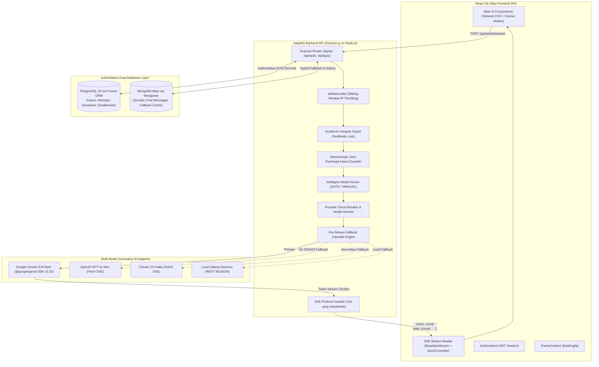
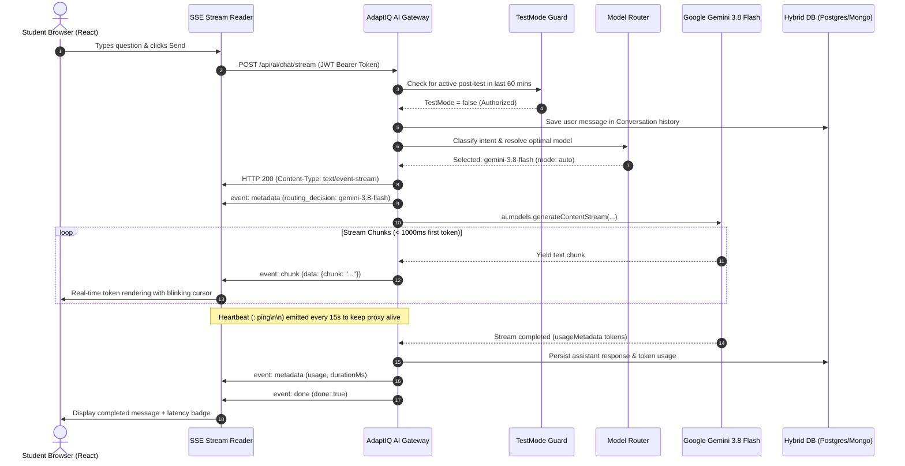
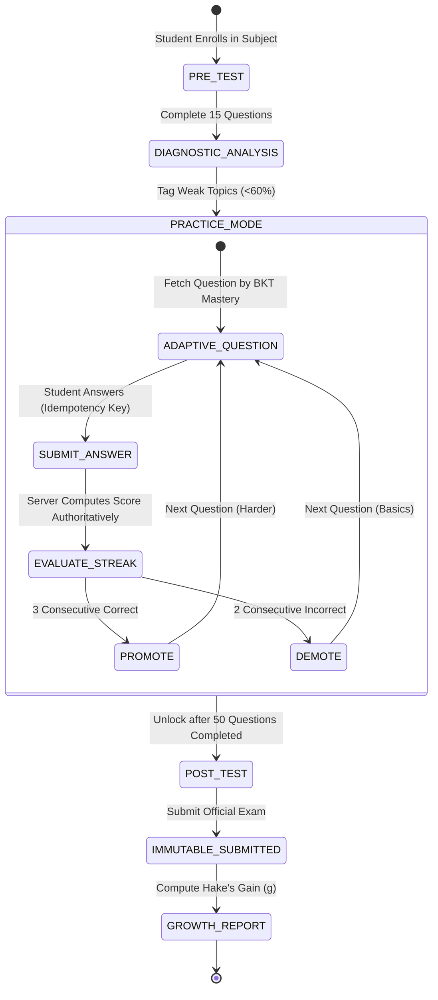
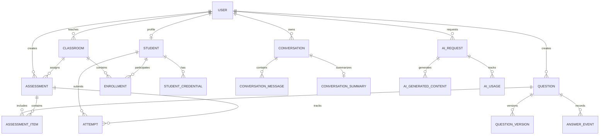

# 🏛️ AdaptIQ — System Architecture & Design Diagrams

This document contains the structural, behavioral, and data-flow diagrams of the AdaptIQ platform formatted using standard Mermaid diagrams.

---

## 1. High-Level Multi-Tier System Architecture

---

## 2. Real-Time Server-Sent Events (SSE) Streaming Sequence Diagram

---

## 3. Assessment Lifecycle & Idempotency State Machine

---

## 4. Prisma PostgreSQL Entity-Relationship Model (ERD)

